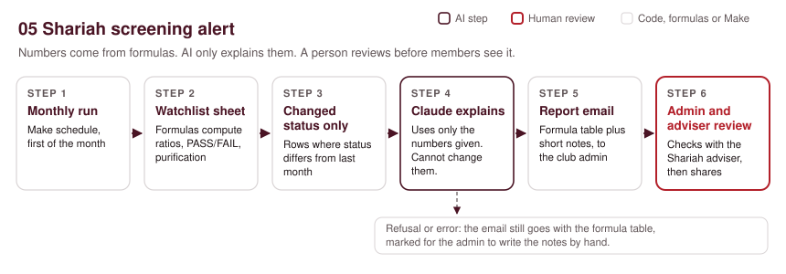
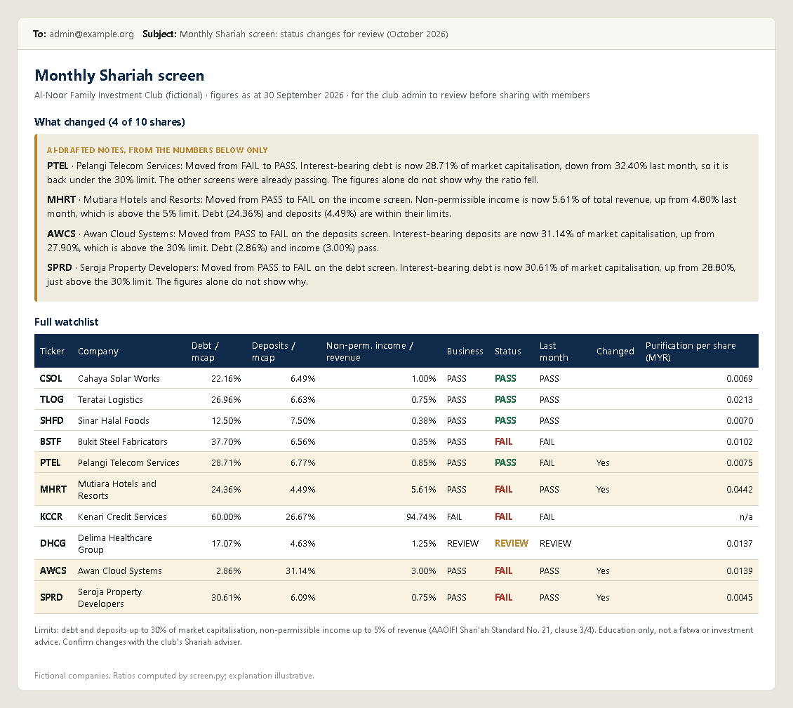

# 05. Shariah screening alert

> Sample scenario. Al-Noor Family Investment Club is a fictional organisation used to demonstrate this build. All data in this folder is made up.

**Problem.** The club's 12 members hold a shared watchlist of listed shares. Once a month one volunteer pulls the latest figures, works out the AAOIFI ratios by hand and tells everyone which shares still pass. It takes an evening, and a slip with a calculator can put a share on the wrong side of a limit.



## Problem
The ratios themselves are simple. The work is in doing them every month for every share, spotting which results changed, and explaining the change to members in plain words. This build does the maths with formulas, only writes to the admin when something changed, and keeps a person between the report and the members.

## What it does
1. **Trigger:** Make runs the scenario on a monthly schedule (set in the scenario's scheduling settings, for example the 1st of each month at 09:00).
2. **Read the watchlist:** Make reads the `Watchlist` tab in Google Sheets. The ratios, PASS/FAIL results, overall status and purification amount are already computed by Sheets formulas that mirror `screen.py`. Make builds an HTML table of every share from those cells.
3. **Find changes:** a second search returns only rows where `status_changed` is YES (this month's status differs from last month's).
4. **AI step:** Claude gets those rows as text and writes two or three plain sentences per share explaining which screen caused the change. It is told to use only the numbers it is given and is not allowed to change, recompute or contradict them.
5. **Output:** one email to the club admin with the AI notes and the full formula table underneath. If Claude refuses or stops early, a second route sends the table with a note asking the admin to write the explanations by hand.
6. **Human check:** the admin reads the report, confirms any status change with the club's Shariah adviser, then shares it with members. After review the admin copies this month's `overall_status` and ratio columns into the `prev_` columns, so the baseline only moves after a person has looked.

If nothing changed this month, step 3 returns no rows and no email is sent.

## The AI step

**Model:** `claude-opus-5-5` through Make's HTTP module, `POST https://api.anthropic.com/v1/messages`, with `output_config.effort: "low"` and a JSON schema so the reply is always parseable. No temperature, top_p or thinking settings are sent.

**Exact prompt** (`{{4.text}}` is filled by Make with one line per changed share, built from the sheet cells):

```text
You are helping the admin of a small family investment club write a monthly Shariah screening note. The shares below changed screening status since last month. Every ratio, limit and status was computed by a spreadsheet formula before you saw it.

Screens and limits (AAOIFI Shari'ah Standard No. 21, clause 3/4): interest-bearing debt up to 30% of market capitalisation; interest-bearing deposits up to 30% of market capitalisation; non-permissible income up to 5% of total revenue; business activity must be permissible.

For each share, write two or three short, plain-English sentences saying which screen or screens caused the change. Quote this month's ratio, last month's ratio and the limit exactly as given.

Rules:
1. Use only the numbers given. Do not recalculate, re-round, estimate or add any number.
2. Do not change or contradict any status. If the data looks inconsistent, write 'figures need checking' and set needs_human_check to true.
3. Do not say why the company's figures moved (for example, new borrowing) unless the data says so. If the cause is not in the data, say the figures alone do not show why.
4. Do not give a Shariah ruling, a fatwa, or a buy, sell or hold recommendation.
5. Plain British English. No em dashes.

Shares: {{4.text}}
```

One line of `{{4.text}}` looks like this:

```text
ticker=SPRD, company=Seroja Property Developers, status last month=PASS, status now=FAIL, debt ratio now=30.61% (last month 28.80%), deposits ratio now=6.09% (last month 6.20%), income ratio now=0.75% (last month 0.74%), business activity screen=PASS
```

**JSON schema it must return:**

```json
{
  "type": "object",
  "properties": {
    "explanations": {
      "type": "array",
      "items": {
        "type": "object",
        "properties": {
          "ticker": { "type": "string" },
          "screens_that_changed": {
            "type": "array",
            "items": { "type": "string", "enum": ["debt", "deposits", "income", "business_activity"] }
          },
          "explanation": { "type": "string" },
          "needs_human_check": { "type": "boolean" }
        },
        "required": ["ticker", "screens_that_changed", "explanation", "needs_human_check"],
        "additionalProperties": false
      }
    }
  },
  "required": ["explanations"],
  "additionalProperties": false
}
```

**What the AI is NOT allowed to do**
- Calculate, recalculate, round or invent any ratio or amount. The numbers in the email table come straight from the sheet; the AI text sits beside them, not in place of them.
- Change or contradict a PASS, FAIL or REVIEW status.
- Guess at company events that are not in the data.
- Give a Shariah ruling, a fatwa, or buy, sell or hold advice.

Make reads the reply from the content block whose `type` is `text` (empty `thinking` blocks can come first) and only uses it when `stop_reason` is `end_turn`. A `refusal` or any other stop reason goes to the hand-written route.

## Example output

**Screening numbers: real output.** The table below is a real run of `python screen.py` on the fictional companies in `sample/watchlist_financials.csv`. The full result is in `sample/screening_output.csv`.

| Ticker | Debt / mcap | Deposits / mcap | Non-perm. income / revenue | Business | Status | Last month | Changed | Purification per share (MYR) |
|---|---:|---:|---:|---|---|---|---|---:|
| CSOL | 22.16% | 6.49% | 1.00% | PASS | PASS | PASS | | 0.0069 |
| TLOG | 26.96% | 6.63% | 0.75% | PASS | PASS | PASS | | 0.0213 |
| SHFD | 12.50% | 7.50% | 0.38% | PASS | PASS | PASS | | 0.0070 |
| BSTF | 37.70% | 6.56% | 0.35% | PASS | FAIL | FAIL | | 0.0102 |
| PTEL | 28.71% | 6.77% | 0.85% | PASS | PASS | FAIL | Yes | 0.0075 |
| MHRT | 24.36% | 4.49% | 5.61% | PASS | FAIL | PASS | Yes | 0.0442 |
| KCCR | 60.00% | 26.67% | 94.74% | FAIL | FAIL | FAIL | | n/a |
| DHCG | 17.07% | 4.63% | 1.25% | REVIEW | REVIEW | REVIEW | | 0.0137 |
| AWCS | 2.86% | 31.14% | 3.00% | PASS | FAIL | PASS | Yes | 0.0139 |
| SPRD | 30.61% | 6.09% | 0.75% | PASS | FAIL | PASS | Yes | 0.0045 |

Purification per share is the company's non-permissible income divided by its shares outstanding (SS 21, 3/4/6/4), from the last reported annual figures. A member holding 1,000 PTEL shares would set aside 1,000 x 0.0075 = MYR 7.50. It is left blank for KCCR because its core business fails, so the screen result is to exit rather than purify and hold.

**AI explanation: illustrative.** Illustrative example written to show the output format. It is not from a live run.

```json
{
  "explanations": [
    {
      "ticker": "PTEL",
      "screens_that_changed": ["debt"],
      "explanation": "Moved from FAIL to PASS. Interest-bearing debt is now 28.71% of market capitalisation, down from 32.40% last month, so it is back under the 30% limit. The figures alone do not show why the ratio fell.",
      "needs_human_check": false
    },
    {
      "ticker": "MHRT",
      "screens_that_changed": ["income"],
      "explanation": "Moved from PASS to FAIL on the income screen. Non-permissible income is now 5.61% of total revenue, up from 4.80% last month, which is above the 5% limit.",
      "needs_human_check": false
    }
  ]
}
```



## Set it up
1. Copy `sample/watchlist_financials.csv` into a Google Sheet, tab name `Watchlist`. Columns A to N are the inputs (A `ticker` to N `prev_status`). Add the formula columns O to X below, filled down for every row.
2. Format O, P, Q and the `prev_` ratio columns (K, L, M) as percentages with 2 decimals, so the AI sees the same figures as the table.
3. Import `blueprint.json` into Make.com (Scenarios, Import blueprint).
4. Connect your Google account to the two Sheets modules and the two Gmail modules, and pick your sheet in place of `PICK_YOUR_SHEET`.
5. Put your Anthropic API key in Make, not in the file. In the HTTP module, the header shows `YOUR_ANTHROPIC_API_KEY` as a placeholder. Replace it with a Make keychain (API key authentication, header name `x-api-key`) or a stored connection. Never paste the key into a shared blueprint or sheet.
6. Change `admin@example.org` to the club admin's address.
7. Set the schedule to monthly. Run once with the sample data and check the email.
8. To check the formulas, run `python screen.py` locally on the same figures. The sheet and the script should agree to 4 decimal places.

The Sheets search modules return columns by position (`1.\`0\`` is column A, `1.\`14\`` is column O). If you add or move columns, remap the fields in modules 2, 4 and the email after import.

### Sheets formulas (row 2, fill down)

These mirror `screen.py` exactly. "Does not exceed" means a ratio exactly at the limit passes.

| Col | Header | Formula |
|---|---|---|
| O | debt_ratio | `=IF(AND(ISNUMBER(E2),E2>0,ISNUMBER(F2)),F2/E2,"")` |
| P | deposits_ratio | `=IF(AND(ISNUMBER(E2),E2>0,ISNUMBER(G2)),G2/E2,"")` |
| Q | income_ratio | `=IF(AND(ISNUMBER(H2),H2>0,ISNUMBER(I2)),I2/H2,"")` |
| R | business_screen | `=IF(LOWER(D2)="permissible","PASS",IF(LOWER(D2)="prohibited","FAIL","REVIEW"))` |
| S | debt_screen | `=IF(O2="","DATA MISSING",IF(O2<=0.3,"PASS","FAIL"))` |
| T | deposits_screen | `=IF(P2="","DATA MISSING",IF(P2<=0.3,"PASS","FAIL"))` |
| U | income_screen | `=IF(Q2="","DATA MISSING",IF(Q2<=0.05,"PASS","FAIL"))` |
| V | overall_status | `=IF(COUNTIF(R2:U2,"FAIL")>0,"FAIL",IF(COUNTIF(R2:U2,"DATA MISSING")>0,"DATA MISSING",IF(R2="REVIEW","REVIEW","PASS")))` |
| W | status_changed | `=IF(AND(N2<>"",UPPER(N2)<>V2),"YES","NO")` |
| X | purification_per_share | `=IF(OR(R2="FAIL",NOT(ISNUMBER(I2)),NOT(ISNUMBER(J2)),J2<=0,I2<=0),"",ROUND(I2/J2,4))` |

## Thresholds and where they come from

I checked the limits against the official AAOIFI text: Shari'ah Standard No. 21, *Financial Paper (Shares and Bonds)*, issued 20 May 2004, PDF on aaoifi.com. Clause 3/4 sets the conditions for holding shares in companies whose main activity is permissible but which borrow or deposit on interest:

- 3/4/1: the company's memorandum must not state dealing in interest or prohibited goods as an objective (the business-activity screen).
- 3/4/2: "the collective amount raised as loan on interest ... does not exceed 30% of the market capitalization of the corporation".
- 3/4/3: "the total amount of interest-taking deposits ... shall not exceed 30% of the market capitalization of total equity". The English wording here is awkward; `screen.py` reads it as market capitalisation, as most secondary sources do. Check with your adviser.
- 3/4/4: "the amount of income generated from prohibited component does not exceed 5% of the total income of the corporation".
- 3/4/5: figures come from the latest financial statements.
- 3/4/6/4: purification per share is total prohibited income divided by the number of shares, multiplied by the shares held.

The standard also says interest-based borrowing and deposits are prohibited whatever the amount. The 30% limits are a tolerance for holding shares, not a statement that the borrowing is acceptable.

**Methods differ.** Standard setters, Shariah boards and index providers do not all screen the same way. Some divide debt and cash by total assets instead of market capitalisation. Some use one third (about 33%) instead of 30%. Some average market capitalisation over 12, 24 or 36 months, and some add further screens such as receivables or illiquid assets. The same share can pass one method and fail another. The thresholds are constants at the top of `screen.py`, so a club that follows a different method can change them in one place (and in the formulas).

This tool is for education and club discussion. It is not a fatwa and it is not investment advice. A qualified Shariah adviser should confirm any status before members act on it.

## Cost per run
- **Make.com operations:** about 9 per monthly run with 10 shares and 4 changes (2 sheet searches, 3 text aggregators, 1 HTTP call, 1 JSON parse, 1 iterator, 1 email). Routers do not use operations. Months with no changes stop after the second search, about 3 operations.
- **Claude tokens:** about 1,000 input tokens (prompt, schema and 4 changed rows) and about 450 output tokens. At `claude-opus-5-5` prices ($4 per million input, $20 per million output) that is roughly $0.004 + $0.009 = **about $0.013 a month**.
- **Cheaper option:** switching the `model` field to `claude-haiku-5-5` ($0.10 / $0.50 per million) brings this to well under $0.001 a run. For one club the saving is tiny; it matters more for someone screening hundreds of portfolios. Your choice.

## Limits and safeguards
- **The AI never does the maths.** Ratios, statuses and purification come from formulas (or `screen.py`). The email table is built from sheet cells, not from the AI reply, so a wrong sentence cannot change a number members see.
- **Business activity is a judgement.** The sheet's `business_activity` column (permissible, prohibited or review) is set by a person. Anything marked review stays REVIEW until the adviser decides.
- **Data quality.** The screen is only as good as the figures typed into the sheet. Missing figures give DATA MISSING, never PASS.
- **Point-in-time market cap.** The sample uses one market cap figure per company. Prices move daily, so a share near 30% can flip between months. Some methods use averages to smooth this.
- **Refusals and errors.** A `refusal` or any stop reason other than `end_turn` sends the admin the table with a note to write explanations by hand. HTTP and email errors retry three times.
- **Text in the request body.** Changed rows are inserted into a JSON body. Company names containing double quotes would break it; keep names plain or strip quotes in the sheet.
- **Not advice.** Education only, not a fatwa or investment advice. The admin and the club's Shariah adviser review before anything is shared.

## Before you switch it on
After importing, reconnect your own accounts and check each module's settings before you switch the scenario on. Points to check: the HTTP module's raw JSON body fields (`contentType: json`, `inputMethod: jsonString`, `jsonStringBodyContent`) and the Text aggregator settings (`util:TextAggregator`, row separator) are my best reading of Make's export format; the monthly schedule lives in the scenario settings, not in the blueprint.

## Tools
Google Sheets, Make.com, Claude API (`claude-opus-5-5`), Gmail, Python 3 standard library (`screen.py`).

Built by Nimotallahi Abiodun Durojaiye · [Portfolio](https://magenta-cactus-05d764.netlify.app)
