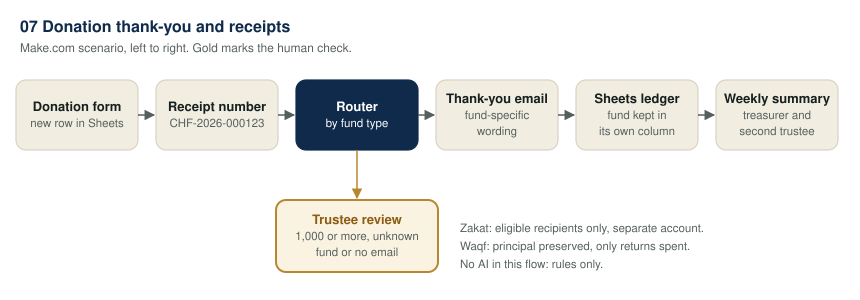
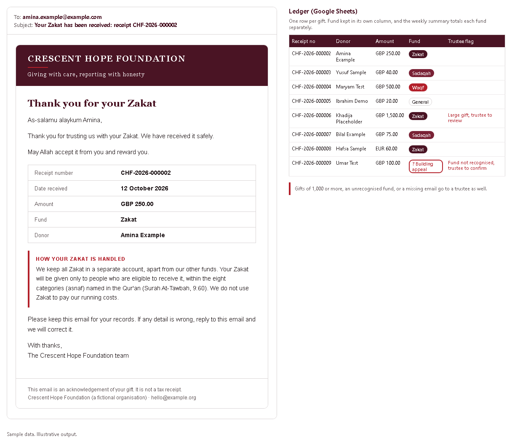
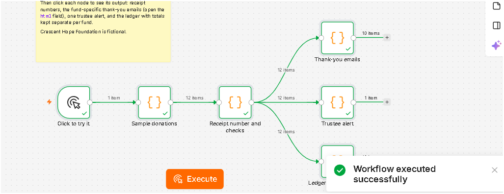
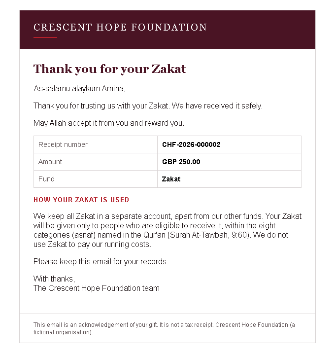

# 07. Donation thank-you and receipts

> Sample scenario. Crescent Hope Foundation is a fictional organisation used to demonstrate this build. All data in this folder is made up.

**Problem.** Crescent Hope Foundation is a small Muslim charity. Donors give through an online form, then wait days for a thank-you and a receipt while a volunteer copies each gift into a spreadsheet by hand.



## Problem
Gifts arrive at all hours, and the volunteer who answers them works one evening a week. Donors who give Zakat want to know it will be handled correctly, and the treasurer needs Zakat, Sadaqah, Waqf and general gifts kept apart in the books. Copying by hand is slow, and mistakes in the fund column are hard to spot later.

## What it does
1. **Trigger:** a new row appears in the donation form's Google Sheet (donor name, email, amount, currency, fund type, message).
2. **Receipt number:** the flow builds a receipt number from the year and the sheet row number, for example row 123 becomes `CHF-2026-000123`. The same row always gives the same number.
3. **Router by fund type:** a rules-based Router picks one of four branded emails: Zakat, Sadaqah, Waqf or General. Each has its own wording (see below).
4. **Ledger:** every gift is logged to a `Ledger` tab with the fund in its own column, plus whether a thank-you went out and any trustee flag.
5. **Trustee check:** gifts of 1,000 or more, gifts with a fund type the flow does not recognise, and gifts with no email address are sent to a trustee. Large gifts still get the automatic thank-you; the trustee alert is in addition, so a person can check the payment and thank the donor personally. Unrecognised funds and missing emails get no automatic email at all.
6. **Weekly summary:** a second small scenario (`blueprint-weekly-summary.json`) runs every Monday and emails the treasurer and a second trustee one line per fund for the last 7 days. Zakat is never added to other funds in a single total.

### Fund-specific wording
Every email opens with "As-salamu alaykum" and the donor's first name, and includes the du'a "May Allah accept it from you and reward you." Arabic script is left out on purpose.

| Fund | What the email says |
|---|---|
| Zakat | Zakat is kept in a separate account and given only to eligible recipients within the eight categories (asnaf) named in Surah At-Tawbah, 9:60. It states that Zakat is not used for running costs. |
| Waqf | The principal is preserved and invested in Shariah-compliant ways. Only the returns are spent. |
| Sadaqah | Supports general programmes: food parcels, school costs, emergency help. |
| General | Supports programme work and the running costs that keep the charity going. |

## Why no AI
This one needs no AI. A rules-based flow is cheaper and more predictable. The fund type comes from a dropdown, the receipt number comes from the row number, and the wording is fixed and checked in advance. A model would add cost and a small chance of getting the Zakat or Waqf wording wrong, with nothing gained.

## Example output
Templates rendered with sample data. Illustrative example written to show the output format. It is not from a live run.



Zakat email for the first sample row (`sample/donations.csv`, row 2):

```
To:      amina.example@example.com
Subject: Your Zakat has been received: receipt CHF-2026-000002

As-salamu alaykum Amina,
Thank you for trusting us with your Zakat. We have received it safely.
May Allah accept it from you and reward you.

Receipt number  CHF-2026-000002
Date received   12 October 2026
Amount          GBP 250.00
Fund            Zakat
Donor           Amina Example

How your Zakat is handled
We keep all Zakat in a separate account, apart from our other funds. Your Zakat
will be given only to people who are eligible to receive it, within the eight
categories (asnaf) named in the Qur'an (Surah At-Tawbah, 9:60). We do not use
Zakat to pay our running costs.

This email is an acknowledgement of your gift. It is not a tax receipt.
```

Weekly summary built from `sample/weekly-summary.csv` (what the Sheets formulas would show for the sample week):

| Fund | Gifts | Total GBP | Gifts in other currencies | Flagged |
|---|---|---|---|---|
| Zakat | 4 | 1,750.00 | 2 | 1 |
| Sadaqah | 3 | 145.00 | 0 | 1 |
| Waqf | 2 | 1,500.00 | 0 | 1 |
| General | 2 | 35.00 | 0 | 0 |
| Unrecognised fund | 1 | 100.00 | 0 | 1 |

## Set it up
1. In Google Sheets, make a donations sheet with a `Form_Responses` tab, columns A to H: Timestamp, Donor name, Email, Amount, Currency, Fund type, Show my name in reports, Message. Make the fund type a dropdown with exactly: Zakat, Sadaqah, Waqf, General. `sample/donations.csv` has test rows.
2. Make a ledger sheet with a `Ledger` tab whose header row matches `sample/ledger.csv`, and a `Weekly_Summary` tab with columns A to F: Fund, Gifts, Total GBP, Gifts in other currencies, Flagged, Week ending. Put one fund per row (Zakat, Sadaqah, Waqf, General) and fill the numbers with formulas, for example in row 2:
   - Gifts: `=COUNTIFS(Ledger!G:G,A2,Ledger!B:B,">="&TODAY()-7)`
   - Total GBP: `=SUMIFS(Ledger!E:E,Ledger!G:G,A2,Ledger!F:F,"GBP",Ledger!B:B,">="&TODAY()-7)`
   - Gifts in other currencies: `=COUNTIFS(Ledger!G:G,A2,Ledger!F:F,"<>GBP",Ledger!B:B,">="&TODAY()-7)`
   - Flagged: `=COUNTIFS(Ledger!G:G,A2,Ledger!I:I,"?*",Ledger!B:B,">="&TODAY()-7)`
   - Add a fifth row for unrecognised funds using `"Unrecognised*"` as the fund match.
3. Import `blueprint.json` into Make.com (Create a new scenario, then Import Blueprint). Connect your Google account on each Sheets and Gmail module and pick your sheets where it says `PICK_YOUR_DONATIONS_SHEET` and `PICK_YOUR_LEDGER_SHEET`.
4. Open the **Set variables** module. The large-gift threshold (1,000) is in the `largeGift` formula. Change it there; it is the only place.
5. Replace `trustee@example.org` and `treasurer@example.org` with real addresses, and the error-watcher URL with your own webhook (or delete the error handlers).
6. Edit the email footer: your charity name, contact address, and your charity registration number if you have one.
7. Import `blueprint-weekly-summary.json` as a second scenario and schedule it weekly (for example, Monday 08:00).
8. Test with `sample/donations.csv`. Check the receipt numbers, the ledger rows and which emails went where before you switch it on.

## Cost per run
- **Per gift:** about 4 Make operations (watch rows, set variables, ledger row, one thank-you email), or 5 when a trustee alert is sent. Routers do not use operations.
- **Polling:** the trigger also uses 1 operation each time it checks for new rows, even when there are none. Checking every 15 minutes is roughly 2,900 checks a month, so a slower interval saves operations.
- **Weekly summary:** 3 operations a week.
- **AI tokens:** none.

## Limits and safeguards
- **Shariah wording.** The Zakat, Waqf and Sadaqah wording here is a sensible starting point, not a ruling. Wording on Zakat collection and distribution should be confirmed with the charity's Shariah adviser. Scholars differ on some points, for example whether a share may go to those who administer Zakat (one of the eight categories), so the "not used for running costs" line must match the charity's actual policy before it is sent.
- **Not a tax receipt.** Tax-receipt rules depend on the country. This receipt is an acknowledgement, not a tax receipt, unless the charity is registered to issue one and adds the details the law requires. The footer says so.
- **Large or unusual gifts** (1,000 or more, an unknown fund type, or no email) go to a trustee. The threshold is a single number in one module. It ignores currency, so set it with your usual currency in mind.
- **Fund type must come from a dropdown.** If someone types a fund by hand, the flow will not guess. It holds the gift for a trustee instead of sending the wrong wording.
- **Receipt numbers follow row numbers.** If someone deletes or sorts rows in the form sheet, numbers can repeat. Protect the form tab and never sort it.
- **Refunds and corrections** are not handled. A person edits the ledger and replies to the donor.
- **Data.** Donor details stay in your own Google account. Keep the ledger shared only with the people who need it.

## Before you switch it on
After importing, reconnect your own accounts and check each module's settings before you switch the scenario on. Points to check: the receipt-number formula (Make has no pad function, so it uses `substring`), the `&` operator inside `if()`, the row-number field name (`__ROW_NUMBER__`), the `util:SetVariables` and `util:TextAggregator` module names, and the filter operator names (`number:greater`, `text:notcontain`, `exist`). These are my best match to Make's export format.

## Tools
Google Forms, Google Sheets, Gmail, Make.com.

## Run it on n8n instead

The same flow is also built for [n8n](https://n8n.io), in the `n8n/` folder.

| File | What it does |
|:-|:-|
| `n8n/try-it-now.workflow.json` | Runs on the made-up donations with no accounts or keys. Import it and click **Test workflow** to see receipt numbers, the thank-you emails, the trustee alert and the fund totals. |
| `n8n/full.workflow.json` | The working version: Google Sheets trigger, the same rules, Gmail thank-yous, a trustee email and a ledger row. |

**To import:** in n8n, open **Workflows**, choose **Create workflow**, then the **...** menu at the top right and **Import from file**. Pick one of the files above.

**For the full version:** connect Google Sheets in **New donation row** and **Ledger row**, connect Gmail in **Send thank-you** and **Email trustee**, and change the trustee address in **Trustee alert**. Test with your own email in the sheet before you switch it on.

The rules live in one Code node, **Receipt number and checks**. The large-gift threshold is `LARGE_GIFT` at the top of that node.





Built by Nimotallahi Abiodun Durojaiye · [Portfolio](https://magenta-cactus-05d764.netlify.app)
